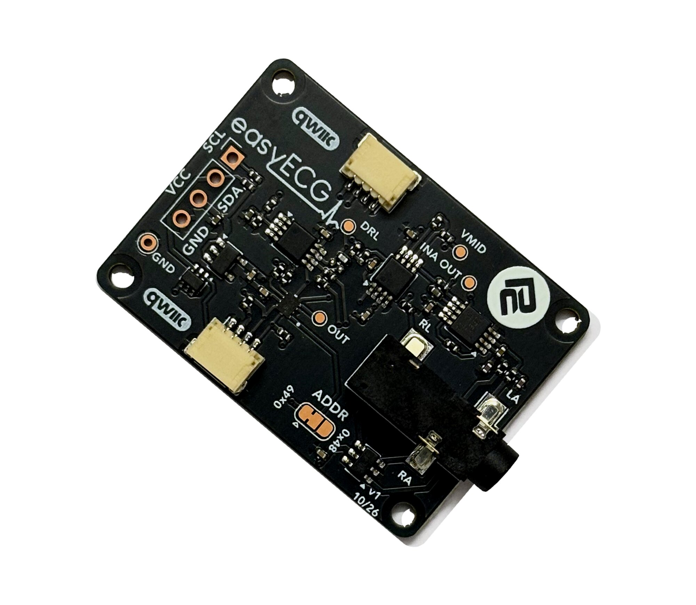

# Protocentral easyECG MicroPython Library

[](https://github.com/Protocentral/protocentral-micropython-easyecg/actions/workflows/test.yml)
[](https://github.com/Protocentral/protocentral-micropython-easyecg/actions/workflows/publish.yml)

MicroPython library for the **Protocentral easyECG Breakout**: single-lead (Lead I) ECG over I²C / Qwiic. It handles the sampling, filtering and heart-rate detection. The same driver also runs on a Raspberry Pi.

## Don't have one? [Buy it here](https://protocentral.com/product/easyecg-single-lead-ecg-breakout-qwiic/)



**Wiring, electrode placement and troubleshooting are in the [easyECG Getting Started guide](https://protocentral.com/product/easyecg-single-lead-ecg-breakout-qwiic/docs/getting-started/).**

## Links

| | |
|---|---|
| Product page | https://protocentral.com/product/easyecg-single-lead-ecg-breakout-qwiic/ |
| Getting Started guide | https://protocentral.com/product/easyecg-single-lead-ecg-breakout-qwiic/docs/getting-started/ |
| Arduino library | https://github.com/Protocentral/protocentral_easyecg_arduino |
| Hardware design files | https://github.com/Protocentral/protocentral_easyecg_hardware |

## Features

- Paced sampling with missed-sample counting: 250 SPS in, 125 or 250 Hz out
- 50/60 Hz notch and 40 Hz low-pass in software; no high-pass by default, to keep the ST segment
- Heart rate from a simplified Pan-Tompkins R-peak detector
- Saturation, mains-pickup and a provisional lead-off flag
- Readings in µV at the electrodes
- A port of the [Arduino library](https://github.com/Protocentral/protocentral_easyecg_arduino) 1.0.0: the same API in snake_case, and a Python version of every Arduino example

> **Not a medical device. For research and education only.** The breakout has no patient isolation: when electrodes are on a person, power the host from a battery or connect through an [easyISO isolated Qwiic adapter](https://protocentral.com/product/easyiso-isolated-qwiic-adapter/). On a mains-powered host you get a flat line, and `is_saturated()` reports it.

## Installation

**MicroPython** (Raspberry Pi Pico, ESP32, …):

```bash
mpremote mip install github:Protocentral/protocentral-micropython-easyecg
```

This also installs the [TLA20xx driver](https://github.com/Protocentral/protocentral-micropython-tla20xx). With Thonny, copy `protocentral_easyecg.py` and `protocentral_tla20xx.py` to the board instead.

**Raspberry Pi**, with I²C enabled (`sudo raspi-config nonint do_i2c 0`):

```bash
python3 -m venv ~/easyecg && source ~/easyecg/bin/activate
pip install protocentral-easyecg
```

## Quick Start

```python
from machine import Pin, I2C
from protocentral_easyecg import EasyECG

i2c = I2C(0, scl=Pin(5), sda=Pin(4), freq=400000)   # Pico: GP5, GP4. Change for your board
ecg = EasyECG(i2c)                                  # default address 0x49
if not ecg.begin():
    raise OSError("easyECG not found")

while True:
    if ecg.update():                                # True at the output rate, 125 Hz
        print(ecg.ecg_microvolts(), ecg.heart_rate())
```

On a Raspberry Pi, replace the I²C lines with `from protocentral_tla20xx_linux import I2C` and `EasyECG(I2C(bus=1))`.

Call `update()` as often as you can; it samples only when the clock is due, and never blocks. If `missed_samples()` grows, your loop is too slow.

## API Reference

| Method | Description |
|---|---|
| `EasyECG(i2c, address=0x49)` / `begin()` | Construct / configure the ADC. `begin()` returns `False` if the board doesn't answer |
| `update()` | Non-blocking. `True` when a new output sample is ready |
| `ecg_microvolts()` / `ecg_filtered()` | Filtered output, in µV at the electrodes / in counts |
| `ecg_unfiltered_microvolts()` / `ecg_unfiltered()` | Plain ADC average |
| `heart_rate()` / `beat_detected()` / `last_rr_millis()` | bpm, 0 until established / true once per beat / last R-R interval |
| `is_saturated()` / `is_lead_off()` / `mains_microvolts()` | Signal-quality flags; lead-off is a provisional heuristic |
| `set_sampling(adc, out)` / `missed_samples()` | Sample clock (default 250, 125) / samples the loop couldn't take on time |
| `set_notch(hz)` / `set_low_pass(hz)` / `set_high_pass(hz)` | Filters: 50 Hz, 40 Hz, off by default. 0 disables |
| `calibrate_baseline(ms)` / `set_baseline(n)` | Measure and subtract the resting offset |

The full API, including the low-level ADC passthroughs, is documented in [protocentral_easyecg.py](https://github.com/Protocentral/protocentral-micropython-easyecg/blob/main/protocentral_easyecg.py).

## Examples

| # | Example | Description |
|---|---|---|
| 01 | `easyecg_simpletest.py` / `easyecg_raspberrypi.py` | Filtered ECG in counts and µV (MicroPython / Raspberry Pi) |
| 02 | `easyecg_plotter.py` | Filtered and unfiltered traces for Thonny's plotter |
| 03 | `easyecg_heartrate.py` | Heart rate on every beat, with saturation and lead-off messages |
| 04 | `easyecg_openview.py` | Stream to [OpenView](https://github.com/Protocentral/protocentral_openview) 3.4+ (**easyECG Breakout**). Save it to the board as `main.py`, then close Thonny or `mpremote` before connecting OpenView |
| 05 | `easyecg_diagnostics.py` | I²C, ADC, noise, mains and sample-rate checks. **Run this first if something is wrong** |

The examples default to QT Py ESP32-C3 pins: change the `I2C(...)` line for your board.

## License

- **Software:** MIT, see [LICENSE.md](https://github.com/Protocentral/protocentral-micropython-easyecg/blob/main/LICENSE.md)
- **Hardware:** CERN-OHL-P v2, in the [hardware repo](https://github.com/Protocentral/protocentral_easyecg_hardware)

Copyright (c) 2026 Protocentral Electronics.

## Support

Open an issue on [GitHub](https://github.com/Protocentral/protocentral-micropython-easyecg/issues) or email support@protocentral.com.
